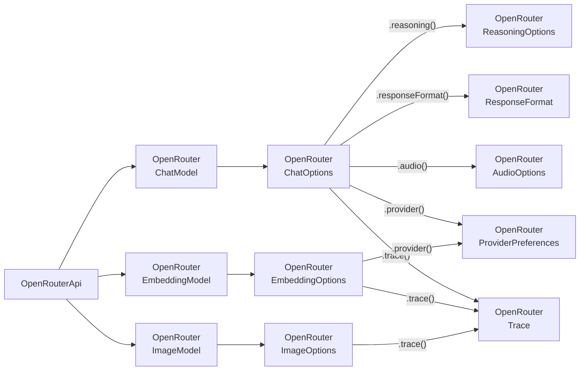

<p align="center">
  
</p>

<h1 align="center">OpenRouter Spring AI</h1>

<p align="center">Native OpenRouter integration for Spring AI</p>

<p align="center">
  <a href="https://central.sonatype.com/artifact/de.subhransu/openrouter-spring-ai-starter"></a>
  
  <a href="LICENSE"></a>
  <br>
  <a href="https://github.com/Subhransu-De/openrouter-spring-ai/actions/workflows/ci.yml"></a>
  <a href="https://github.com/Subhransu-De/openrouter-spring-ai/actions/workflows/codeql.yml"></a>
</p>

> [!IMPORTANT]
> **Under active development.** This library has not reached 1.0.0, so public names and options can still change between releases. The [changelog](CHANGELOG.md) lists every change with upgrade notes. Please try it in your projects and [open an issue](https://github.com/Subhransu-De/openrouter-spring-ai/issues) when something breaks or is missing.

A native [Spring AI](https://spring.io/projects/spring-ai) integration for [OpenRouter](https://openrouter.ai), which routes each request to an upstream model provider. It adds typed model fallbacks, provider routing, reasoning replay, cost accounting and attribution headers under `spring.ai.openrouter.*`. Spring AI's OpenAI integration can also send OpenRouter fields through [`extraBody`](https://github.com/spring-projects/spring-ai/blob/v2.0.2/models/spring-ai-openai/src/main/java/org/springframework/ai/openai/OpenAiChatOptions.java). This library adds typed support for them.

> **Community project:** This library is independently maintained and is not affiliated with, endorsed by, or an official project of OpenRouter or Spring AI.
>
> Install only one OpenRouter Spring AI starter in an application. Combining this starter with another OpenRouter starter can make provider selection and bean creation order-dependent.

[Getting started](docs/getting-started.md) · [Documentation](docs/README.md) · [Changelog](CHANGELOG.md)


## What it does

- Chat through OpenRouter's Chat Completions endpoint, with synchronous calls and SSE streaming. The Responses endpoint is an experimental opt-in.
- Tool calling through Spring AI's `ToolCallingAdvisor`, including streamed argument fragments and [strict function tools](docs/tool-calling.md#strict-function-tools).
- [Reasoning options](docs/reasoning-and-caching.md), with reasoning text and opaque reasoning state replayed across tool rounds.
- [Model fallback lists, provider routing, service tiers and attribution headers](docs/chat-options.md#routing-fallbacks-and-attribution), plus [optional OpenRouter fields](docs/extensions.md).
- Usage accounting with cost, cached and reasoning tokens, and Micrometer observations.
- Embeddings behind Spring AI's `EmbeddingModel`, and text and image documents behind `DocumentEmbeddingModel`. See [Embeddings](docs/embeddings.md).
- Image, PDF, audio and video inputs, image generation, and streamed chat audio output. See [Images, documents and audio](docs/multimodal.md).
- Text-to-speech behind Spring AI's `TextToSpeechModel`, with streamed audio, and transcription behind `TranscriptionModel`. See [Text-to-speech](docs/multimodal.md#text-to-speech) and [Transcription](docs/multimodal.md#transcription).
- Spring Boot auto-configuration under `spring.ai.openrouter.*`.

Not supported yet: the models catalogue endpoint, OpenRouter server-side tools such as the web search plugin, voice cloning and multi-speaker speech, and multipart transcription uploads.

## Install

Add the starter from Maven Central:

```xml
<dependency>
    <groupId>de.subhransu</groupId>
    <artifactId>openrouter-spring-ai-starter</artifactId>
    <version>0.1.0</version>
</dependency>
```

```kotlin
implementation("de.subhransu:openrouter-spring-ai-starter:0.1.0")
```

Use Java 17 or later. See [release compatibility](docs/getting-started.md#release-compatibility) for Spring Boot and Spring AI versions.

## Examples

> [!TIP]
> Every example uses the beans from **Setup**. Each call is a billable OpenRouter request. Model ids are examples; pick any from [OpenRouter models](https://openrouter.ai/models).

### Setup

Spring Boot reads the key from configuration and builds `OpenRouterApi` and the three models for you. Declare a model bean only when you need different defaults.

<details open>
<summary>API key and models, Inject the models, Chat model bean, Embedding model bean, Image model bean, Without auto-configuration</summary>

<table>
<tr>
<td width="170" valign="top">

**[API key and models](docs/getting-started.md)**<br>
<sub>Read from the environment, never hard-coded.</sub>

</td>
<td>

```properties
spring.ai.openrouter.api-key=${OPENROUTER_API_KEY}
spring.ai.openrouter.chat.model=openai/gpt-oss-120b
spring.ai.openrouter.embedding.model=openai/text-embedding-3-small
spring.ai.openrouter.image.model=bytedance-seed/seedream-4.5
```

</td>
</tr>
<tr>
<td width="170" valign="top">

**[Inject the models](docs/getting-started.md)**<br>
<sub>The names the other examples use.</sub>

</td>
<td>

```java
@Service
class Assistant {

    private final ChatClient chatClient;
    private final EmbeddingModel embeddingModel;
    private final OpenRouterImageModel imageModel;

    Assistant(ChatClient.Builder builder, EmbeddingModel embeddingModel,
            OpenRouterImageModel imageModel) {
        this.chatClient = builder.build();
        this.embeddingModel = embeddingModel;
        this.imageModel = imageModel;
    }
}
```

</td>
</tr>
<tr>
<td width="170" valign="top">

**[Chat model bean](docs/chat-options.md)**<br>
<sub>Replaces the auto-configured chat model.</sub>

</td>
<td>

```java
@Bean
OpenRouterChatModel chatModel(OpenRouterApi openRouterApi) {
    return OpenRouterChatModel.builder()
        .openRouterApi(openRouterApi)
        .defaultOptions(OpenRouterChatOptions.builder()
            .model("openai/gpt-oss-120b")
            .build())
        .build();
}
```

</td>
</tr>
<tr>
<td width="170" valign="top">

**[Embedding model bean](docs/embeddings.md)**<br>
<sub>Replaces the auto-configured embedding model.</sub>

</td>
<td>

```java
@Bean
OpenRouterEmbeddingModel embeddingModel(OpenRouterApi openRouterApi) {
    return OpenRouterEmbeddingModel.builder()
        .openRouterApi(openRouterApi)
        .defaultOptions(OpenRouterEmbeddingOptions.builder()
            .model("openai/text-embedding-3-small")
            .build())
        .build();
}
```

</td>
</tr>
<tr>
<td width="170" valign="top">

**[Image model bean](docs/multimodal.md#image-generation)**<br>
<sub>Replaces the auto-configured image model.</sub>

</td>
<td>

```java
@Bean
OpenRouterImageModel imageModel(OpenRouterApi openRouterApi) {
    return OpenRouterImageModel.builder()
        .openRouterApi(openRouterApi)
        .defaultOptions(OpenRouterImageOptions.builder()
            .model("bytedance-seed/seedream-4.5")
            .build())
        .build();
}
```

</td>
</tr>
<tr>
<td width="170" valign="top">

**[Without auto-configuration](docs/api.md)**<br>
<sub>Bind the key into a field.</sub>

</td>
<td>

```java
@Configuration
class OpenRouterConfig {

    @Value("${spring.ai.openrouter.api-key}")
    private String apiKey;

    @Bean
    OpenRouterApi openRouterApi() {
        return OpenRouterApi.builder()
            .apiKey(apiKey)
            .build();
    }
}
```

</td>
</tr>
</table>

</details>

How the builders fit together:



### Text

> [!WARNING]
> Responses mode is experimental and rejects some options. Use Chat Completions, the default, in production. See [Request modes](docs/request-modes.md).

<details open>
<summary>Text generation, Streaming, Per-request options, Structured output, Reasoning, Tool calling, Responses mode</summary>

<table>
<tr>
<td width="170" valign="top">

**[Text generation](docs/getting-started.md)**<br>
<sub>One blocking call.</sub>

</td>
<td>

```java
String answer = chatClient.prompt()
    .user("Say hello.")
    .call()
    .content();
```

</td>
</tr>
<tr>
<td width="170" valign="top">

**[Streaming](docs/request-modes.md#stream-contract)**<br>
<sub>Text arrives as server-sent events.</sub>

</td>
<td>

```java
Flux<String> tokens = chatClient.prompt()
    .user("Tell a short story.")
    .stream()
    .content();
```

</td>
</tr>
<tr>
<td width="170" valign="top">

**[Per-request options](docs/chat-options.md#replacement-and-composition)**<br>
<sub>Unset fields keep the defaults.</sub>

</td>
<td>

```java
String answer = chatClient.prompt()
    .user("Say hello.")
    .options(OpenRouterChatOptions.builder()
        .temperature(0.0)
        .maxCompletionTokens(200))
    .call()
    .content();
```

</td>
</tr>
<tr>
<td width="170" valign="top">

**[Structured output](docs/request-modes.md#structured-output)**<br>
<sub>Typed records from a JSON schema.</sub>

</td>
<td>

```java
record Answer(String answer) {}

Answer answer = chatClient.prompt()
    .user("What is the capital of Norway?")
    .options(OpenRouterChatOptions.builder()
        .responseFormat(OpenRouterResponseFormat.jsonSchema("""
            {"type":"object",
             "properties":{"answer":{"type":"string"}},
             "required":["answer"],
             "additionalProperties":false}""")))
    .call()
    .entity(Answer.class);
```

</td>
</tr>
<tr>
<td width="170" valign="top">

**[Reasoning](docs/reasoning-and-caching.md)**<br>
<sub>Read the model's thinking separately.</sub>

</td>
<td>

```java
ChatResponse response = chatClient.prompt()
    .user("Plan a three-step migration.")
    .options(OpenRouterChatOptions.builder()
        .reasoning(OpenRouterReasoningOptions.builder()
            .effort(OpenRouterReasoningEffort.MEDIUM)
            .build()))
    .call()
    .chatResponse();
String thinking = OpenRouterMetadata.reasoning(response.getResult())
    .orElse("");
```

</td>
</tr>
<tr>
<td width="170" valign="top">

**[Tool calling](docs/tool-calling.md)**<br>
<sub>Spring AI runs the tool loop.</sub>

</td>
<td>

```java
class Weather {

    @Tool(description = "Current temperature in a city")
    String temperature(String city) {
        return "21 C in " + city;
    }
}

String answer = chatClient.prompt()
    .user("How warm is it in Oslo?")
    .tools(new Weather())
    .call()
    .content();
```

</td>
</tr>
<tr>
<td width="170" valign="top">

**[Responses mode](docs/request-modes.md)** <sup>experimental</sup><br>
<sub>Sends to the /responses endpoint.</sub>

</td>
<td>

```java
String answer = chatClient.prompt()
    .user("Say hello.")
    .options(OpenRouterChatOptions.builder()
        .requestMode(OpenRouterRequestMode.RESPONSES))
    .call()
    .content();
```

</td>
</tr>
</table>

</details>

### Routing

<details>
<summary>Model fallbacks, Provider routing, Service tier, Sessions and traces, Attribution headers</summary>

<table>
<tr>
<td width="170" valign="top">

**[Model fallbacks](docs/chat-options.md#routing-fallbacks-and-attribution)**<br>
<sub>Tried in order when one fails.</sub>

</td>
<td>

```java
String answer = chatClient.prompt()
    .user("Summarize this ticket.")
    .options(OpenRouterChatOptions.builder()
        .model("openai/gpt-oss-120b")
        .models(List.of("openai/gpt-oss-20b")))
    .call()
    .content();
```

</td>
</tr>
<tr>
<td width="170" valign="top">

**[Provider routing](docs/chat-options.md#routing-fallbacks-and-attribution)**<br>
<sub>Pick, order and sort providers.</sub>

</td>
<td>

```java
String answer = chatClient.prompt()
    .user("Say hello.")
    .options(OpenRouterChatOptions.builder()
        .provider(OpenRouterProviderPreferences.builder()
            .sort(OpenRouterProviderSort.THROUGHPUT)
            .build()))
    .call()
    .content();
```

</td>
</tr>
<tr>
<td width="170" valign="top">

**[Service tier](docs/chat-options.md#routing-fallbacks-and-attribution)**<br>
<sub>Trade speed for price.</sub>

</td>
<td>

```java
String answer = chatClient.prompt()
    .user("Say hello.")
    .options(OpenRouterChatOptions.builder()
        .serviceTier(OpenRouterServiceTier.FLEX))
    .call()
    .content();
```

</td>
</tr>
<tr>
<td width="170" valign="top">

**[Sessions and traces](docs/chat-options.md#sessions-and-traces)**<br>
<sub>Keep a conversation on one provider.</sub>

</td>
<td>

```java
String answer = chatClient.prompt()
    .user(question)
    .options(OpenRouterChatOptions.builder()
        .sessionId(conversationId)
        .trace(OpenRouterTrace.builder()
            .traceId(runId)
            .build()))
    .call()
    .content();
```

</td>
</tr>
<tr>
<td width="170" valign="top">

**[Attribution headers](docs/chat-options.md#routing-fallbacks-and-attribution)**<br>
<sub>Your app on OpenRouter rankings.</sub>

</td>
<td>

```properties
spring.ai.openrouter.app.http-referer=https://example.com
spring.ai.openrouter.app.title=Example app
```

</td>
</tr>
</table>

</details>

### Inputs

<details>
<summary>Image input, PDF input, Audio input, Video input</summary>

<table>
<tr>
<td width="170" valign="top">

**[Image input](docs/multimodal.md#image-inputs)**<br>
<sub>Needs a model that reads images.</sub>

</td>
<td>

```java
UserMessage message = UserMessage.builder()
    .text("What is in this image?")
    .media(Media.builder()
        .mimeType(MimeTypeUtils.IMAGE_PNG)
        .data(URI.create("https://example.com/cat.png"))
        .build())
    .build();
String answer = chatClient.prompt()
    .messages(message)
    .options(OpenRouterChatOptions.builder()
        .model("google/gemini-2.5-flash"))
    .call()
    .content();
```

</td>
</tr>
<tr>
<td width="170" valign="top">

**[PDF input](docs/multimodal.md#pdf-audio-and-video-inputs)**<br>
<sub>A URL, bytes or a data URL.</sub>

</td>
<td>

```java
UserMessage message = UserMessage.builder()
    .text("Summarize the attached document.")
    .media(Media.builder()
        .mimeType(MimeTypeUtils.parseMimeType("application/pdf"))
        .data(URI.create("https://example.com/report.pdf"))
        .build())
    .build();
String summary = chatClient.prompt()
    .messages(message)
    .options(OpenRouterChatOptions.builder()
        .model("google/gemini-2.5-flash"))
    .call()
    .content();
```

</td>
</tr>
<tr>
<td width="170" valign="top">

**[Audio input](docs/multimodal.md#pdf-audio-and-video-inputs)**<br>
<sub>Bytes only; URLs are rejected.</sub>

</td>
<td>

```java
UserMessage message = UserMessage.builder()
    .text("Transcribe this clip.")
    .media(Media.builder()
        .mimeType(MimeTypeUtils.parseMimeType("audio/wav"))
        .data(Files.readAllBytes(Path.of("clip.wav")))
        .build())
    .build();
String transcript = chatClient.prompt()
    .messages(message)
    .options(OpenRouterChatOptions.builder()
        .model("google/gemini-2.5-flash"))
    .call()
    .content();
```

</td>
</tr>
<tr>
<td width="170" valign="top">

**[Video input](docs/multimodal.md#pdf-audio-and-video-inputs)**<br>
<sub>URL support depends on the provider.</sub>

</td>
<td>

```java
UserMessage message = UserMessage.builder()
    .text("What happens in this video?")
    .media(Media.builder()
        .mimeType(MimeTypeUtils.parseMimeType("video/mp4"))
        .data(URI.create("https://example.com/clip.mp4"))
        .build())
    .build();
String answer = chatClient.prompt()
    .messages(message)
    .options(OpenRouterChatOptions.builder()
        .model("google/gemini-2.5-flash"))
    .call()
    .content();
```

</td>
</tr>
</table>

</details>

### Outputs

<details>
<summary>Image generation, Image streaming, Image to image, Images from a chat model, Audio output</summary>

<table>
<tr>
<td width="170" valign="top">

**[Image generation](docs/multimodal.md#image-generation)**<br>
<sub>Base64 images from the Image API.</sub>

</td>
<td>

```java
ImageResponse response = imageModel.call(
    new ImagePrompt("a red panda wearing sunglasses"));
String base64 = response.getResult().getOutput().getB64Json();
```

</td>
</tr>
<tr>
<td width="170" valign="top">

**[Image streaming](docs/multimodal.md#streaming)**<br>
<sub>Previews first, then the final image.</sub>

</td>
<td>

```java
Flux<ImageResponse> events = imageModel.stream(
    new ImagePrompt("a red panda wearing sunglasses"));
events.subscribe(response -> response.getResults().forEach(result -> {
    boolean preview = OpenRouterImageGenerationMetadata.from(result)
        .isPartial();
}));
```

</td>
</tr>
<tr>
<td width="170" valign="top">

**[Image to image](docs/multimodal.md#image-options)**<br>
<sub>Start from a reference image.</sub>

</td>
<td>

```java
ImageResponse response = imageModel.call(new ImagePrompt(
    "the same sketch as a watercolour",
    OpenRouterImageOptions.builder()
        .inputReferences(List.of("https://example.com/sketch.png"))
        .build()));
```

</td>
</tr>
<tr>
<td width="170" valign="top">

**[Images from a chat model](docs/multimodal.md#chat-models-with-image-output)**<br>
<sub>Images next to text in a reply.</sub>

</td>
<td>

```java
ChatResponse response = chatClient.prompt()
    .user("Draw a lighthouse at dusk.")
    .options(OpenRouterChatOptions.builder()
        .model("google/gemini-2.5-flash-image")
        .modalities(OpenRouterModality.IMAGE, OpenRouterModality.TEXT))
    .call()
    .chatResponse();
for (Media image : response.getResult().getOutput().getMedia()) {
    byte[] png = OpenRouterMedia.bytes(image);
}
```

</td>
</tr>
<tr>
<td width="170" valign="top">

**[Audio output](docs/multimodal.md#chat-audio-output)**<br>
<sub>Streaming only.</sub>

</td>
<td>

```java
Flux<ChatResponse> stream = chatClient.prompt()
    .user("Say hello.")
    .options(OpenRouterChatOptions.builder()
        .model("openai/gpt-4o-audio-preview")
        .modalities(OpenRouterModality.TEXT, OpenRouterModality.AUDIO)
        .audio(new OpenRouterAudioOptions("alloy", "wav")))
    .stream()
    .chatResponse();
stream.subscribe(response -> response.getResults().forEach(result ->
    result.getOutput().getMedia().forEach(media -> {
        byte[] wav = OpenRouterMedia.bytes(media);
    })));
```

</td>
</tr>
</table>

</details>

### Embeddings

<details>
<summary>Text embedding, Batch with options</summary>

<table>
<tr>
<td width="170" valign="top">

**[Text embedding](docs/embeddings.md)**<br>
<sub>Works with Spring AI vector stores.</sub>

</td>
<td>

```java
float[] vector = embeddingModel.embed("The quick brown fox");
```

</td>
</tr>
<tr>
<td width="170" valign="top">

**[Batch with options](docs/embeddings.md)**<br>
<sub>Options merge with the defaults.</sub>

</td>
<td>

```java
EmbeddingResponse response = embeddingModel.call(new EmbeddingRequest(
    List.of("first text", "second text"),
    OpenRouterEmbeddingOptions.builder()
        .dimensions(256)
        .build()));
```

</td>
</tr>
</table>

</details>

### Caching and usage

<details>
<summary>Prompt cache breakpoint, Usage and cost, Extra request fields, Low-level request</summary>

<table>
<tr>
<td width="170" valign="top">

**[Prompt cache breakpoint](docs/reasoning-and-caching.md#explicit-prompt-cache-breakpoints)**<br>
<sub>Cache a stable prompt prefix.</sub>

</td>
<td>

```java
String reference = "Reference material to reuse.\n";
UserMessage message = UserMessage.builder()
    .text(reference + "Answer this turn's question.")
    .metadata(Map.of(OpenRouterCacheBreakpoint.METADATA_KEY,
        List.of(new OpenRouterCacheBreakpoint(reference.length()))))
    .build();
String answer = chatClient.prompt()
    .messages(message)
    .call()
    .content();
```

</td>
</tr>
<tr>
<td width="170" valign="top">

**[Usage and cost](docs/observability.md)**<br>
<sub>Credits charged, tokens used.</sub>

</td>
<td>

```java
ChatResponse response = chatClient.prompt()
    .user("Say hello.")
    .call()
    .chatResponse();
OpenRouterUsage usage = OpenRouterUsage.from(response);
Double cost = usage.getCost(); // null when not reported
```

</td>
</tr>
<tr>
<td width="170" valign="top">

**[Extra request fields](docs/extensions.md)**<br>
<sub>Fields without a typed option.</sub>

</td>
<td>

```java
String answer = chatClient.prompt()
    .user("Say hello.")
    .options(OpenRouterChatOptions.builder()
        .extraBody(Map.of("transforms", List.of())))
    .call()
    .content();
```

</td>
</tr>
<tr>
<td width="170" valign="top">

**[Low-level request](docs/api.md#build-low-level-requests)**<br>
<sub>Inject OpenRouterApi; no Spring AI types.</sub>

</td>
<td>

```java
ChatCompletionRequest request = ChatCompletionRequest.builder()
    .model("openai/gpt-oss-120b")
    .messages(List.of(
        new ChatMessage("user", "Say hello.", null, null, null)))
    .build();
ChatCompletionResponse response = openRouterApi.chatCompletion(request);
```

</td>
</tr>
</table>

</details>

## Documentation

| Page                                         | Covers                                                                                                                          |
| -------------------------------------------- | ------------------------------------------------------------------------------------------------------------------------------- |
| [Getting started](docs/getting-started.md)   | Install, first call, properties, compatibility, model selection.                                                                |
| [Chat options](docs/chat-options.md)         | How runtime options combine with defaults; fallbacks, provider routing and attribution.                                         |
| [Request modes](docs/request-modes.md)       | Chat Completions and experimental Responses.                                                                                    |
| [Supported API and nullability](docs/api.md) | Types applications can depend on, null contracts.                                                                               |
| [Tool calling](docs/tool-calling.md)         | Tools, strict schemas, failure policy.                                                                                          |
| [More pages](docs/README.md)                 | Extensions, reasoning and caching, errors and retries, HTTP and limits, multimodal, embeddings, observability, the Garage demo. |

## Modules

Applications add `openrouter-spring-ai-starter`, which brings in the core library `openrouter-spring-ai` and its auto-configuration. `openrouter-spring-ai-samples` is the [Garage demo](docs/garage.md).

## License

Released under the [MIT License](LICENSE).
